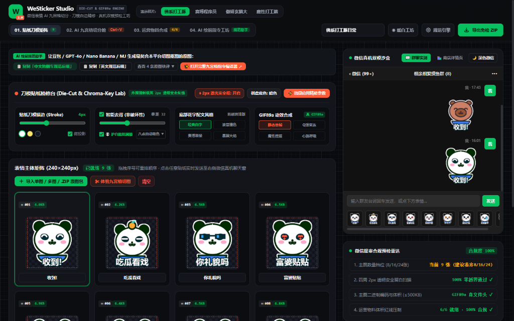
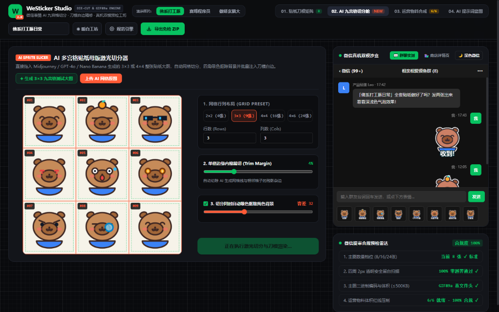
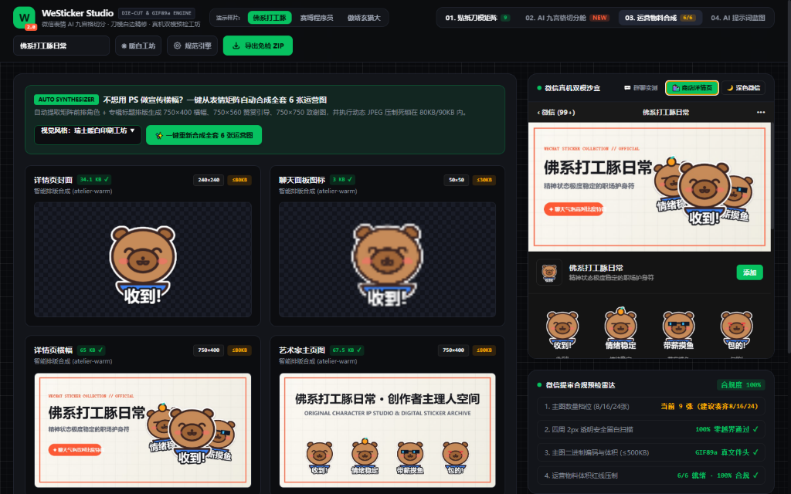
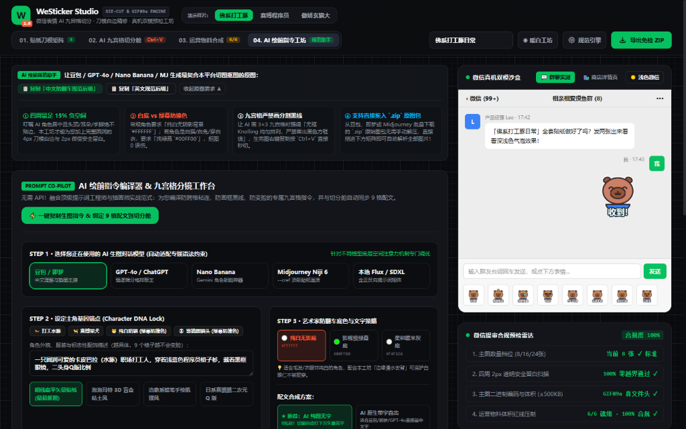
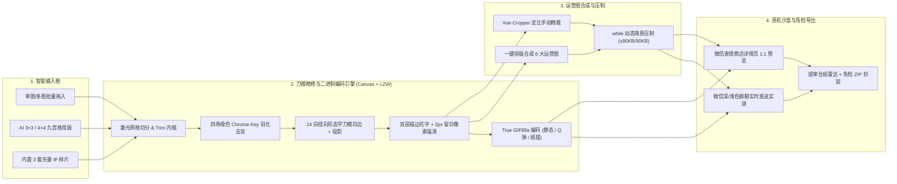

<div align="center">

# 🎨 WeSticker Studio 2.0

**微信表情开放平台 · AI 九宫格切分、刀模白边精修与真机双模预检一体机**  
*AI-Native Sticker Engineering, Morphological Die-Cut Crafting & Live WeChat Device Simulation Workbench*

[](https://vuejs.org/)
[](https://vitejs.dev/)
[](https://www.typescriptlang.org/)
[](https://tailwindcss.com/)
[](#)
[](#)

[✨ 核心特性](#-核心特性与痛点终结) •
[📸 实机界面快照](#-工作台实机预览) •
[🧬 视觉处理流水线](#-纯前端视觉与编码架构) •
[📐 微信官方 7 大规范表](#-内置微信表情开放平台-7-大硬核规范) •
[🚀 快速开始](#-快速开始)

</div>

---

<div align="center">
  
  <p><em>▲ 图 1：WeSticker Studio 2.0 主工作台 —— 左侧「贴纸刀模描边 + 2px 激光安全框 + 行内花字重绘」，右侧「iPhone 微信深色群聊实时发送测试 + 提审预检雷达」</em></p>
</div>

---

## 💡 为什么重构为 WeSticker Studio 2.0？

在 AI 绘画（Midjourney / GPT-4o / Nano Banana / Flux）普及后，生成表情原图只需 10 秒，但**上架微信表情开放平台依然是创作者的噩梦**。传统切图打包小工具只解决了最后 10% 的“改尺寸打包”，却忽略了创作者前 90% 的真实痛点：

| 创作链路痛点 | 传统工具 / 旧版 v1.0 | 🚀 **WeSticker Studio 2.0 (本项目)** |
| :--- | :--- | :--- |
| **1. AI 产图形态** | 假设用户已有 24 张切好的独立透明 PNG，需自行用 PS 切图 | **内置「AI 九宫格/多宫格激光切分舱」**，拖入 1 张 `3×3` 或 `4×4` 大图，1 秒切出 9~24 张独立贴纸 |
| **2. 纯色背景抠图** | AI 生成图多为白底/暖灰底/绿幕，需依赖第三方抠图网站 | **纯前端「四角自动吸色 + 欧氏色差羽化去背」**，切分同时瞬间转为柔和透明通道 |
| **3. 深色模式隐身** | 无描边能力，深色角色在微信深色模式 (`#111111`) 下完全看不清 | **24 向径向形态学「刀模贴纸白边 (`0~10px`) + 微投影」**，深浅聊天气泡通吃 |
| **4. 汉字乱码与配文** | AI 直出中文常乱码，后期用美图秀秀逐张加字极易越界 | **内置 4 套双层描边「防越界撞色花字引擎」**，卡片行内改字实时重绘，严格避让 `2px` 留白红线 |
| **5. 伪 GIF 格式驳回** | 仅把 `.png` 改后缀为 `.gif`，无真 GIF 文件头且无法动起来 | **手写纯前端 `GIF89a` LZW 二进制编码器**，支持一键合成 **Q弹果冻 / 魔性摇摆 / 心跳呼吸** 动态帧 |
| **6. 运营大图设计难** | 强制用户自己去 PS 拼 `750×400` 横幅与 `750×560` 赞赏引导图 | **「零 PS 一键自动合成全套 6 张运营物料」** + 动态质量步进压制死锁在 `80KB / 90KB` 红线内 |
| **7. 缺乏上屏实测** | 导出 ZIP 上传后台才发现字太小、白边不匀或存在边缘杂色 | **常驻「微信真机双模沙盒」**（深浅色群聊点击即发 + 表情商店详情页 1:1 预览 + 提审合规雷达） |

---

## 📸 工作台实机预览

### 01. 刀模贴纸矩阵 & 微信真机深浅色群聊沙盒
> 开箱内置 **「佛系打工豚」、「赛博程序员阿柴」、「傲娇玄猫大王」** 3 套程序化矢量样片；支持拖拽重排编号、开启 `2px` 激光出血红线、调整刀模白边粗细，点击任意卡片即可实时发送到右侧微信聊天窗检验深/浅色背景对比度。

<div align="center">
  
</div>

### 02. AI 九宫格/多宫格母版激光切分舱 (AI Sprite Sheet Slicer)
> 针对 Midjourney / GPT-4o 产出的多宫格角色贴纸母版，支持 `2×2 (4张)`、`3×3 (9张)`、`4×4 (16张)`、`4×6 (24张)` 实时激光网格对齐、单格边缘内缩裁切（Trim Margin 消除相邻格子杂边），并在切分同时自动抠除纯色背景导入主矩阵。

<div align="center">
  
</div>

### 03. 6 大运营物料一键合成中心 & 微信表情商店详情页 1:1 预览
> 无需打开 Photoshop！选择 4 套高审美视觉主题（瑞士暖白印刷工坊 / 微信原生翡翠黑金 / 新野兽派高街波普 / 黑曜石极客网格），一键从表情矩阵自动排版生成 **封面图、聊天图标、详情页横幅、艺术家主页、赞赏引导图、赞赏致谢图**，并实时渲染在右侧微信商店详情页沙盒中。同时完整保留 `vue-cropper` 定比手动精裁能力。

<div align="center">
  
</div>

### 04. AI 绘前指令编译器 & 九宫格分镜工作台 (Prompt Co-Pilot)
> 无需接入任何付费生图 API！针对 **豆包/即梦 (Seedream)、GPT-4o、Nano Banana (Gemini)、Midjourney Niji 6、本地 Flux/SDXL** 五大主流模型底层注意力特性，提供主角基因锚定、白底/绿幕防撞色底色策略、分批连贯生成剧本（Batch A/B/C 轻松凑齐 16/24 张）以及九宫格配文同源绑定。复制指令生图后，直接右键复制图片回本页按 **`Ctrl + V`** 即可秒切并自动贴入 9 句配文；同时支持直接拖入未解压的 `.zip` 原始素材图包。

<div align="center">
  
</div>

---

## 🧬 纯前端视觉与编码架构

所有图像切分、色度抠图、形态学膨胀描边、GIF89a LZW 编码与 ZIP 归档 **100% 在浏览器本地内存执行**，零后端服务器依赖、零隐私泄露风险：



---

## 📐 内置微信表情开放平台 7 大硬核规范

系统默认严格锁死以下微信官方标准参数，同时支持通过右上角 **`⚙️ 规范引擎`** 弹窗自由覆写并持久化至 `localStorage`（随时可一键恢复官方默认值）：

| 序号 | 物料类别 | 导出路径与命名 | 官方尺寸 (px) | 格式要求 | 体积红线 | Studio 2.0 自动化策略 |
| :---: | :--- | :--- | :---: | :---: | :---: | :--- |
| **01** | **表情主体** | `/表情主体/01.gif` ~ `24.gif` | `240 × 240` | GIF / PNG | `≤ 500 KB` | 自动居中缩放、刀模白边、强制清空四周 `2px` 透明安全留白，支持真 `GIF89a` 编码 |
| **02** | **表情缩略图** | `/表情缩略图/01.png` ~ `24.png` | `120 × 120` | PNG (透明) | `≤ 200 KB` | 零交互后台静默同步派生，保持透明底色与花字同步 |
| **03** | **聊天面板图标** | `/聊天图标_icon.png` | `50 × 50` | PNG (透明) | `≤ 30 KB` | 默认取首张主图无损降采样生成，支持 `1:1` 真实像素预览与手动替换 |
| **04** | **详情页封面图** | `/封面图_cover.png` | `240 × 240` | PNG (透明) | `≤ 80 KB` | 默认取首张主图，或点击矩阵任意卡片上的「封面」按钮一键指定 |
| **05** | **详情页横幅图** | `/横幅图_banner.jpg` | `750 × 400` | JPG / PNG | **`≤ 80 KB`** | 支持一键提取前 3 张角色智能排版合成，或 `75:40` 定比裁切 + 动态降质压制 |
| **06** | **艺术家主页图** | `/艺术家主页_artist.jpg` | `750 × 400` | JPG / PNG | **`≤ 80 KB`** | 支持一键提取 4 张角色阵列合成，或 `75:40` 定比裁切 + 动态降质压制 |
| **07** | **赞赏引导 / 致谢图** | `/赞赏引导_reward_guide.jpg`<br>`/赞赏致谢_reward_thanks.jpg` | `750 × 560`<br>`750 × 750` | JPG / PNG | **`≤ 90 KB`**<br>`≤ 200 KB` | 支持一键合成投喂引导卡与致谢弹窗卡，并在商店模拟器中点击「赞赏作者」实测弹窗 |

---

## 📦 一键导出免检 ZIP 目录树

```text
/{专辑名称}_WeChat.zip
  └── /{专辑名称}_WeChat/
        ├── 表情主体/
        │     ├── 01.gif          (240×240, 真 GIF89a 含透明通道与 2px 留白)
        │     ├── 02.gif
        │     └── ...
        ├── 表情缩略图/
        │     ├── 01.png          (120×120, 全透明 PNG)
        │     ├── 02.png
        │     └── ...
        ├── 封面图_cover.png       (240×240, PNG ≤ 80KB)
        ├── 聊天图标_icon.png      (50×50, PNG ≤ 30KB)
        ├── 横幅图_banner.jpg      (750×400, JPEG 极限压制 ≤ 80KB)
        ├── 艺术家主页_artist.jpg   (750×400, JPEG 极限压制 ≤ 80KB)
        ├── 赞赏引导_reward_guide.jpg (750×560, JPEG 极限压制 ≤ 90KB)
        ├── 赞赏致谢_reward_thanks.jpg (750×750, JPEG 极限压制 ≤ 200KB)
        └── 提审自检报告_manifest.txt (逐文件精确尺寸、配文与 KB 体积审计报告)
```

---

## 🚀 快速开始

### 1. 环境要求
- **Node.js**: `>= 18.0.0` (推荐 `v20+` 或 `v22+`)

### 2. 安装与启动
```bash
# 克隆仓库
git clone https://github.com/EgoistInory/WeSticker.git
cd WeSticker

# 安装依赖
npm install

# 启动本地热更新工作台 (默认 http://localhost:5173)
npm run dev
```

### 3. 生产环境构建校验
```bash
# 执行 TypeScript 严格类型检查与 Vite 生产打包
npm run build
```

---

## 🗂️ 核心工程结构

```text
src/
 ├── App.vue                      # 三栏空间工作台 + 4 大模式切换 + 微信真机双模沙盒
 ├── style.css                    # 瑞士精密刀模切割垫网格与双主题 (Dark/Light) 样式系统
 └── utils/
      ├── imageProcessor.ts       # 核心视觉引擎：九宫格切分、色度抠图、24向刀模白边、花字与运营图自动合成
      ├── gifEncoder.ts           # 纯前端二进制 GIF89a LZW 编码器与微动效帧合成器
      ├── demoPackGenerator.ts    # 内置 3 套矢量 IP 样片、3×3 测试母版生成器与 AI 提示词蓝图库
      └── zipExporter.ts          # 微信官方标准目录树封装与提审自检报告生成器
```
